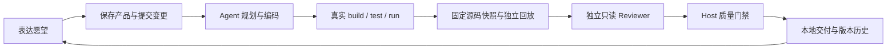

<div align="center">

# 🌿 Wish Willow · 许愿柳

**把软件愿望变成有状态、有证据、可持续演化的产品。**

一个基于原版 **DeepSeek Harness（DSH）** 的独立插件 Bundle。<br>
你表达愿望、做关键决策；Agent 规划与开发，独立 Reviewer 审查，Host 决定是否交付。


[](<LICENSE>)

[功能亮点](#-功能亮点) · [快速开始](#-快速开始) · [验证状态](#-验证状态) · [限制与安全](#-限制与安全) · [开发与文档](#-开发与文档)

</div>

---

> **当前定位：实验性、本地交付工具。** P2 已正式关闭，既定质量门禁验收通过；这不代表任意软件愿望、当前版本的完整 Web/Desktop 体验都已验证。P1 历史例外仍保留，P3 尚未开始实施。当前包版本为 `0.3.2`，尚未发布正式安装发行版。

## 🌱 为什么是 Wish Willow？

聊天能生成代码，但一个持续演化的软件还需要回答：

- 用户究竟确认了什么？哪些只是 Agent 的推断？
- 当前正在做什么，哪里失败了，下一步由谁决定？
- 构建和测试真的执行了吗，还是只有“已经完成”的描述？
- 这次交付对应哪份源码、哪次审查，旧版本是否还在？

Wish Willow 将这些事实保存在**独立于聊天 Session 的产品状态**中，让“许愿 → 开发 → 验证 → 审查 → 交付 → 再许愿”成为可追溯的流程。

## ✨ 功能亮点

| 能力 | 你得到什么 |
|---|---|
| **一个安装单元，一个工作台** | 在 DSH「设置 → Wish Willow」创建与查看产品；P0/P1 内部模块组合在同一 Bundle 中 |
| **自然语言驱动开发** | 主 Agent 顺序规划、编码，真实修改受控项目目录；重大决策留给用户 |
| **产品事实持久化** | 愿望、已确认/推断需求、约束、决策、任务、运行、证据和版本有稳定关联 |
| **真实验证，失败关闭** | build/test/run 分别采集真实前台执行证据；缺失、失败或未验证都不当作交付成功 |
| **独立只读 Reviewer** | Coder 停止后使用 fresh Session，实读候选源码、测试和证据；不继承编码对话 |
| **Host 最终质量门禁** | 核对哈希、身份、审查、风险与状态；高风险本地交付还需候选绑定的用户批准 |
| **不可覆盖的交付历史** | 保存源码快照、独立副本验证及版本记录；新失败不抹去旧交付，也不借旧成功冒充当前成功 |
| **显式恢复与持续演化** | 失败/中断可见，有界重试、显式重审和原候选继续；后续愿望生成新一轮变更 |

**不是自动化万能工具：** 重试不等于断点续跑；跨模型任务接管和通用故障恢复尚未实现。界面目前主要展示路径、命令、状态和证据摘要，不提供内置软件预览或一键运行。

## 🔄 工作流程



- **代码生成 ≠ 测试通过 ≠ 审查通过 ≠ 已交付。** 各阶段分别记录。
- `FAIL`、`BLOCKED`、`UNVERIFIED` 不释放候选；高风险还需要明确批准，批准范围仅为本地交付。
- 失败或中断不会自动无限重跑；既有交付不会被覆盖。重大决策拒绝后的重新规划路径仍有产品闭环缺口，不承诺自动继续。

## 🚀 快速开始

### 环境要求

| 项目 | 当前适用范围 |
|---|---|
| DSH | `0.2.0-rc.2` |
| Cordis | `4.0.4`（清单允许 `~4.0.4`） |
| Node.js | `≥ 22` |
| 平台 | 主要证据来自 Windows；Web/Desktop 共用 Client，但必须分别验证 |
| DSH 能力 | Storage Domain、Typert Gateway、Agent/工具/沙箱、Client Connection、locale 与 Settings Slot |

不要通过版本豁免强行加载其他 DSH 版本；需要你自行在 DSH 中配置可用的默认模型与 preset，**仓库不提供模型凭据**。

### 从源码构建本地安装包

```sh
git clone https://github.com/wangxiaow/dsh-wish-willow.git
cd dsh-wish-willow
pnpm install --frozen-lockfile --ignore-scripts
pnpm run check
pnpm pack --pack-destination artifacts
```

这些是供开发者主动执行的步骤：安装可能联网，检查包含本地测试子进程；不应在未经授权的自动化会话中自行执行。`pnpm pack` 生成的是**本地包**，不是 GitHub Release。重新打包会产生新的归档身份，不能冒充历史验收包。

### 安装到 DSH

1. 打开 DSH 插件管理，选择安装本地压缩包。
2. 填入刚生成的 `artifacts/dsh-wish-willow-0.3.2.tgz` 的**绝对路径**。
3. 按管理器回执决定是否需要重启；需要重启时先保存工作，不要擅自关闭正在使用的 Host。
4. 打开 **设置 → Wish Willow**。

已有旧 P0/P1 双 Bundle 安装时，应先移除 `dsh-wish-willow-p1`，避免重复 Service。历史升级步骤见[升级与回退手册](<docs/WISH-WILLOW-UPGRADE.md>)；该手册的实测对象是旧版本，不能视为 P2 新字段的无损降级保证。同版本重打包可能被管理器拒绝，不要强制覆盖现有安装。

### 开始许愿

1. **创建产品：** 输入名称与软件愿望。此步保存草稿，**不直接启动模型**。
2. **提交执行：** 在产品详情的愿望输入区域提交首次变更（当前界面文案为「提交下一轮愿望」）。此时开始真实 Agent 调用，可能产生模型费用。
3. **查看进展：** 观察任务、实际验证证据、Reviewer 结论和 Host 门禁；按提示处理重大决策或候选审批。
4. **使用交付：** 只有正式交付后，才按版本记录的路径与启动方式在本地运行。命令被展示不等于软件正在运行。
5. **继续演化：** 提交新的愿望；保留已确认事实及历史版本，新增 ChangeSet、构建与交付记录。

遇到 `uncertain` 时，先检查工作目录及未知副作用，再明确重试。**重试编码、重审候选、继续 Host 检查是不同操作，费用和副作用也不同。**

## ✅ 验证状态

| 阶段 | 正式状态 | 证据边界 |
|---|---|---|
| P0 | **已完成** | 插件、持久化和有限 Web/Desktop 基础验收 |
| P1 | **CLOSED WITH ACCEPTED EXCEPTION** | 保留 `EX-P1-032-01`：原 0.3.2 模型驱动的完整成功交付未充分验证 |
| P2 | **CLOSED — VERIFIED, NO EXCEPTION** | 既定 A/B/C 范围和两例真实独立 Reviewer/Gate/Local Release 验收完成 |
| P3 | **NOT STARTED** | 只有规划讨论，没有实施或阶段验收 |

P2 的正例结果为 **PASS / ALLOW / 1 次本地 Release**；刻意缺陷反例为 **FAIL / NEEDS_CHANGES / 0 次 Release**。反例被阻断是预期验收成功，不是用三条命令 exit 0 替代语义审查。

**范围必须分开：** P2 候选由固定输入、无模型 Prepare 生成，随后经过真实 Reviewer；这不等于当前版本已完成普通 Coder 的自然语言端到端交付，也不替代 Web/Desktop 交互验收。旧 0.3.1 的双端记录和旧 0.3.2 的 `92/92 PASS` 仍是各自的历史证据，不能外推。

正式依据：

- [P2 入口与成功验收补记](<docs/P2-C-ENTRY-REPORT.md#10-后续成功验收补记>)
- [P2 固定输入、原生审计与准备证据](<docs/P2-C-PREPARATION-REPORT.md#10-后续成功验收补记>)
- [P2 正式阶段关闭记录](<docs/P2-EXECUTION-PLAN.md#后续成功验收补记>)
- [P1 正式关闭与接受例外](<docs/P1-CLOSURE-0.3.2.md>)

部分研发交接文档保留当时的 NOT RUN/未关闭描述；最新阶段状态以以上正式归档为准。报告中引用的本地保全、安装包和验收 Home 不是公开下载资源；原始模型对话、凭据与大型现场证据不随本次源码提交公开。

## 🛡️ 限制与安全

- **交付支持有限：** 当前可验证范围为无第三方依赖的 Node/PowerShell 应用；不支持通用依赖闭包、任意框架或公网部署承诺。
- **单写入 Host：** 同一存储 root 只允许一个写入 Host；不要让 Web 与 Desktop 同时共写同一 root。
- **Windows 权限：** DSH 沙箱准备可能因 `WRITE_OWNER` 或继承 ACL 条件失败；某个隔离 Home 成功不代表其他目录已满足条件。不要自动提权或修改 ACL。
- **费用不是硬封顶：** 步数、时限及工具调用上限不等于 Token、Provider 请求或金额上限；运行前确认实际模型、内部重试与费用控制。
- **数据保护：** 源码快照排除凭据类文件；旧 Release 和质量历史追加保存。停用/卸载不主动删除产品状态。
- **降级需保全：** 旧 strict 二进制可能拒绝 P2 新字段；不要静默删 `quality` 或覆盖新状态来“兼容”。
- **恢复不是撤销：** 中断不会自动重跑；重试可能存在未知副作用，尚无通用断点续跑、跨模型接管或自动回滚。

产品状态存储于 `wish_willow`（旧 P0）与 `wish_willow_p1`（统一产品演化）Domain。项目源码、候选快照与独立验证副本位于 `$DSH_HOME/wish-willow` 下；备份与恢复应同时考虑状态和相应源码资产，不能只依赖聊天记录。

## 🧩 开发与文档

```text
src/host.js             单一 Bundle 组合根
src/p0/                 旧 P0 产品模块
packages/p1/src/        产品状态、执行、交付、Reviewer 与质量门禁
client.js               统一工作台
scripts/                检查入口
tests/                  单元、组件、集成与显式授权验收驱动
docs/                   产品设计、接口依据和阶段归档
```

- [开发规范与阶段边界](<AGENTS.md>)
- [产品需求](<docs/PRD.md>) · [架构与约束](<docs/ARCHITECTURE.md>) · [API 依据](<docs/API-EVIDENCE.md>)
- [P0 最终验收](<docs/P0-FINAL-ACCEPTANCE.md>) · [P1 历史双端验收](<docs/P1-FINAL-ACCEPTANCE.md>)
- [P2 源码开发交接（历史）](<docs/P2-DEVELOPMENT-REPORT.md>) · [变更记录（按时点保留）](<docs/CHANGELOG.md>)
- [包清单](<package.json>) · [Host 组合根](<src/host.js>) · [统一工作台源码](<client.js>)

脚本化 Agent、模拟 Reviewer、SSR/组件测试不等于真实模型、浏览器或 OS 沙箱证据。真实验收驱动不是产品功能，必须使用新隔离空间并取得对应运行、模型和安装授权；不要对历史成功/失败现场补跑或清理。

欢迎提交问题和建议；请注明 DSH/Wish Willow 版本、平台、操作步骤与脱敏错误。**不要上传 API Key、认证 URL、私人 Session 或完整模型对话。**

## 📄 License

[MIT License](<LICENSE>) · Copyright © 2026 wangxiaow
